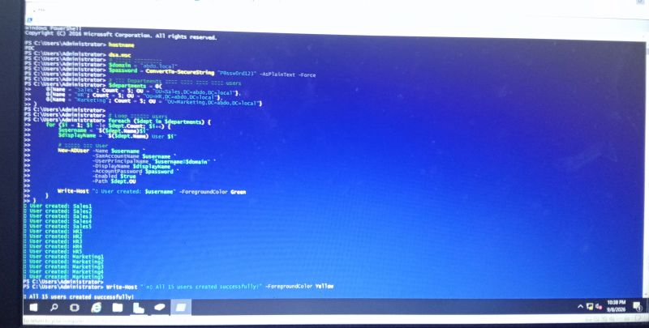
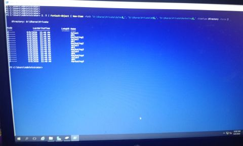
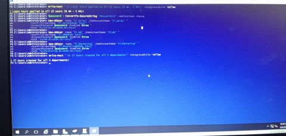
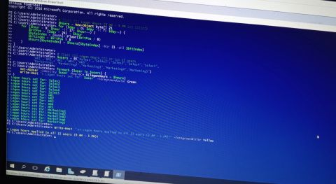

# MCSA Hands-On Project — Complete Windows Server Domain Lab 🖥️

Built from scratch to simulate a real company network: a full **Active Directory domain (`abdo.local`)** on Windows Server 2016, serving **3 departments** (Sales, HR, Marketing) with **15 users** — covering identity, Group Policy, file services, DHCP, DNS, and print services, all tied together the way a real enterprise works.

> Lab environment — `abdo.local` is a private lab domain built on VMware. Originally documented on [LinkedIn](https://www.linkedin.com/feed/update/urn:li:activity:7503944722646822914/).

## 🏗️ Lab overview

| Component | Details |
|---|---|
| Domain | `abdo.local` — Windows Server 2016 promoted to Domain Controller |
| Organizational Units | Sales, HR, Marketing |
| Users | 15 (5 per department), created with a PowerShell script |
| Security Groups | One per department, users added to their group's membership |
| File Services | Shared structure: **Private** / **Department** / **All**, with precise Share + NTFS permissions |
| Mapped Drives (via GPO) | `M:` Private · `N:` Department · `H:` All |
| Network Services | DHCP (scope), DNS (Host/A records + forwarders), Print Server |
| Client | Windows 10 — used to verify drive mappings end-to-end |
| Delegation | `IT_Sales` / `IT_HR` / `IT_Marketing` — password-reset rights per department only (least privilege, no Domain Admin) |

## ⚙️ What was built (21 steps)

**Identity & structure**
1. Promoted Windows Server 2016 to Domain Controller (`abdo.local`)
2. Created 3 Organizational Units — Sales / HR / Marketing
3. Created all 15 users with a **PowerShell script** instead of one-by-one
4. Created a Security Group per department and added its users

**File services**
5. Built the shared folder structure — Private / Department / All
6. Tuned Share & NTFS permissions precisely per department
7. Private folder per user — nobody can see another user's folder, even in the same department 🔒
8. Mapped drives automatically via Group Policy (`M:` Private · `N:` Department · `H:` All)
9. Verified the drives from a real Windows 10 client ✅

**Hardening via Group Policy**
10. Blocked USB drives domain-wide (data-loss prevention)
11. Blocked wallpaper changes (consistent look across machines)
12. Set logon hours (9 AM – 5 PM) for all users at once with a script
13. Sales: Notepad only (Software Restriction Policy)
14. HR: Notepad + Calculator only
15. Marketing: everything allowed except Paint
16. Locked Control Panel domain-wide

**Delegation (least privilege)**
17. Created an IT user per department — `IT_Sales` / `IT_HR` / `IT_Marketing`
18. Delegation of Control: each IT admin can reset passwords **for their own department only** — no Domain Admin rights 🛡️

**Network services**
19. Installed DHCP Server + scope — automatic IP assignment for any joining device
20. Configured DNS — Host/A records + forwarders, so machines resolve the server by name, not just IP
21. Installed Print Server — printers deployed per department via Group Policy, same idea as the mapped drives 🖨️

## 🤖 PowerShell automation

The [`scripts/`](scripts/) folder holds the automation written for this lab:

| Script | What it does |
|---|---|
| [`New-ADLabUsers.ps1`](scripts/New-ADLabUsers.ps1) | Creates the 3 OUs, 15 users and 3 security groups in one run |
| [`New-SharedFolderStructure.ps1`](scripts/New-SharedFolderStructure.ps1) | Builds Private/Department/All shares with explicit NTFS ACLs (group-based, never per-user) |
| [`Set-LogonHours.ps1`](scripts/Set-LogonHours.ps1) | Applies 9 AM – 5 PM logon hours to all users via the `logonHours` bitmask |

## 📸 Screenshots

| | |
|---|---|
|  |  |
|  |  |

## 💡 Key takeaways

- **Why groups, not users:** permissions are granted to Security Groups, never directly to user accounts — one membership change propagates everywhere.
- **Deny-by-default vs allow-by-default:** Sales/HR run on "block everything, allow exceptions" (Software Restriction Policies), Marketing on "allow everything, block one exception" — the policy model follows how each department actually works.
- **Services are one system:** DHCP, DNS, Print Services and Active Directory aren't separate toys — integrated, they form a complete company environment.

## 🛠️ Tech stack

`Windows Server 2016` `Active Directory` `Group Policy` `PowerShell` `DHCP` `DNS` `Print Services` `NTFS` `VMware` `Windows 10`
